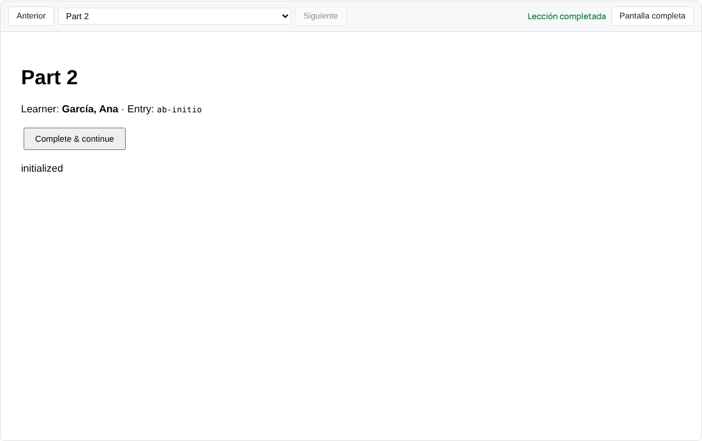
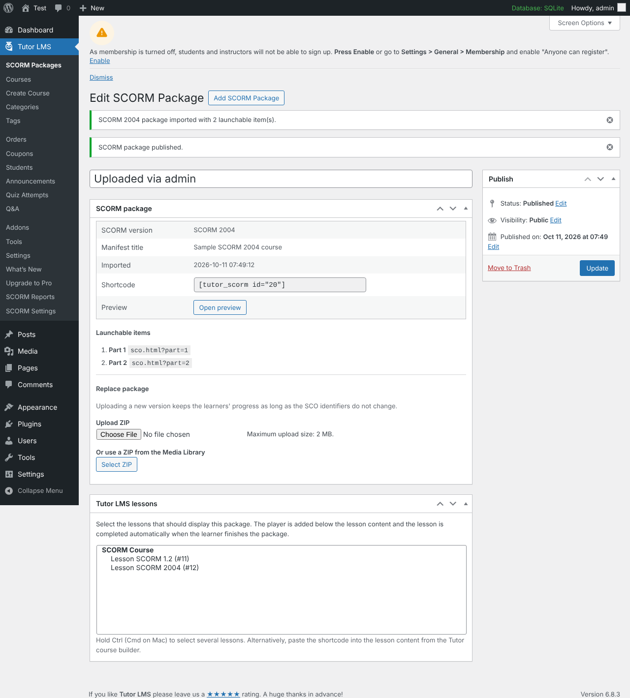

# Tutor SCORM

Plugin de WordPress para **incorporar cursos SCORM 1.2 y SCORM 2004 en Tutor LMS**, pensado para **sustituir la entrega de contenidos por xAPI** (GrassBlade, Tin Canny, H5P + LRS, etc.).

Incluye su propio *runtime* SCORM (la API `API` y `API_1484_11` que buscan los paquetes), guarda el progreso de cada estudiante en WordPress y **marca la lección de Tutor LMS como completada** automáticamente cuando el estudiante termina el paquete. No necesitas un LRS.



## Funcionalidades

- **SCORM 1.2 y SCORM 2004** (3ª y 4ª edición): detección automática de la versión a partir de `imsmanifest.xml`.
- **Importación de paquetes ZIP** desde el editor (subida directa o desde la biblioteca de medios). Admite ZIPs con carpeta contenedora.
- **Reproductor** integrado en la lección (iframe) o en **ventana nueva**, con botón de pantalla completa.
- **Paquetes multi‑SCO**: selector de elementos, botones *Anterior/Siguiente* y navegación SCORM 2004 (`adl.nav.request` = `continue`, `previous`, `choice`).
- **Seguimiento por estudiante y SCO**: estado, puntuación, tiempo total, sesiones, `suspend_data`, ubicación, interacciones, objetivos… Reanudación (`cmi.entry = resume`) cuando el contenido sale con `suspend`.
- Reglas del LMS: *mastery score* (1.2), *completion threshold* y *scaled passing score* (2004).
- **Integración con Tutor LMS**:
  - Asignar el paquete a una o varias lecciones desde la pantalla del paquete o desde la lección (o usar el shortcode).
  - Lección completada automáticamente según la regla configurada; se respeta la opción de Tutor de autocompletar el curso.
  - Oculta el botón «Marcar como completada» de Tutor en lecciones SCORM (opcional).
  - Solo los estudiantes matriculados (o administradores) completan lecciones.
- **Informes** en *Tutor LMS → SCORM Reports*: filtros por paquete/estado, búsqueda de estudiantes, exportación CSV y reinicio de progreso.
- **Ayuda de migración desde xAPI** en *Tutor LMS → SCORM Settings*: lista las lecciones que aún contienen shortcodes o bloques xAPI (GrassBlade, Tin Canny, H5P, cmi5…).
- Traducción al **español (es_ES)** incluida.

## Requisitos

- WordPress 5.8+ y PHP 7.4+ con la extensión **ZipArchive**.
- Tutor LMS (probado con Tutor LMS 4.1.1). Sin Tutor LMS el plugin funciona con el shortcode, pero sin completar lecciones.

## Instalación

1. Copia esta carpeta en `wp-content/plugins/tutor-scorm/` (o comprímela en un ZIP y súbela en *Plugins → Añadir nuevo → Subir plugin*).
2. Activa **Tutor SCORM**.
3. Revisa *Tutor LMS → SCORM Settings*.

## Uso

1. Exporta tu curso como **SCORM 1.2** o **SCORM 2004** desde tu herramienta de autor (Articulate Storyline/Rise, iSpring, Adobe Captivate, Elucidat, dominKnow, H5P…).
2. Ve a *Tutor LMS → SCORM Packages → Añadir paquete SCORM*, sube el ZIP y publica.
3. Asigna el paquete a la lección:
   - en el cuadro **Lecciones de Tutor LMS** de la pantalla del paquete, **o**
   - pegando el shortcode en el contenido de la lección (funciona también desde el constructor de cursos de Tutor):

```text
[tutor_scorm id="123"]
[tutor_scorm id="123" height="720"]
[tutor_scorm id="123" mode="popup"]
```

El reproductor aparece debajo del contenido de la lección. Cuando el estudiante termina el paquete, la lección se marca como completada.



## Migración desde xAPI

1. Abre *Tutor LMS → SCORM Settings* y revisa la tabla **Migración desde xAPI**: muestra cada lección que todavía incrusta contenido xAPI y si ya tiene un paquete SCORM asignado.
2. Para cada curso, vuelve a publicarlo desde la herramienta de autor como **SCORM** (en lugar de *xAPI/Tin Can*), súbelo como paquete y asígnalo a la lección.
3. Elimina de la lección el shortcode o bloque xAPI.
4. Cuando no queden lecciones en la lista, puedes desactivar el plugin xAPI y prescindir del LRS.

> El historial guardado en el LRS no se importa: el progreso SCORM empieza de cero. Las lecciones que Tutor ya tenía marcadas como completadas siguen completadas.

## Ajustes

| Ajuste | Descripción |
| --- | --- |
| Regla para completar la lección | *Completado o aprobado* (recomendado), *Solo aprobado* o *Completado, aprobado o suspendido*. Se aplica a todos los SCO del paquete. |
| Modo de reproductor | Integrado en la lección o en ventana nueva. |
| Altura del reproductor | Altura del iframe en píxeles. |
| Intervalo de autoguardado | Guarda el progreso cada N segundos aunque el contenido no llame a `Commit`. |
| Botón «Marcar como completada» | Lo oculta en lecciones con SCORM. |
| Desinstalación | Borra paquetes, archivos y datos al desinstalar. |

## Seguridad

- Solo los usuarios con `manage_options` pueden subir paquetes (los paquetes contienen HTML/JS que se sirve desde tu dominio). Se puede cambiar con el filtro `tutor_scorm_manage_capability`.
- Al descomprimir se rechazan rutas con `..`, rutas absolutas y archivos ejecutables por el servidor (`.php`, `.phtml`, `.phar`, `.htaccess`, `.user.ini`…). La carpeta `wp-content/uploads/tutor-scorm/` incluye un `.htaccess` que desactiva PHP.
- El manifiesto se analiza sin DTD ni entidades externas (protección XXE).
- Cada reproductor recibe un token HMAC ligado a usuario, paquete y lección; el endpoint REST (`/wp-json/tutor-scorm/v1/commit`) exige sesión iniciada, *nonce* y token válido.
- Los archivos de los paquetes son públicos por URL (como cualquier archivo de `uploads`), en una carpeta con nombre aleatorio.

## Notas técnicas

- **Mismo origen**: el contenido SCORM debe servirse desde el mismo dominio que WordPress para que encuentre la API. Si usas un CDN u *offload* de `uploads` a otro dominio, excluye la carpeta `tutor-scorm`.
- Datos en la tabla `{prefix}tutor_scorm_tracking` (una fila por estudiante + paquete + SCO).
- Un único reproductor por página (la API SCORM es global en la ventana).
- Al reemplazar un paquete se conserva el progreso mientras los identificadores de los SCO no cambien.

### Hooks

| Hook | Tipo | Uso |
| --- | --- | --- |
| `tutor_scorm_manage_capability` | filtro | Capacidad para gestionar paquetes (por defecto `manage_options`). |
| `tutor_scorm_reports_capability` | filtro | Capacidad para ver informes. |
| `tutor_scorm_is_satisfied` | filtro | Personalizar cuándo un SCO cuenta como superado. |
| `tutor_scorm_should_complete_lesson` | filtro | Impedir/permitir completar una lección. |
| `tutor_scorm_runtime_values` | filtro | Valores de solo lectura enviados al contenido (`cmi.learner_name`…). |
| `tutor_scorm_player_config` | filtro | Configuración completa del reproductor. |
| `tutor_scorm_max_uncompressed_size` | filtro | Tamaño máximo descomprimido (2 GB por defecto). |
| `tutor_scorm_xapi_patterns` | filtro | Patrones de detección de contenido xAPI. |
| `tutor_scorm_package_imported` | acción | Tras importar un paquete. |
| `tutor_scorm_tracking_saved` | acción | Tras guardar datos de seguimiento. |
| `tutor_scorm_lesson_completed` | acción | Tras completar una lección por SCORM. |
| `tutor-scorm:lesson-completed` | evento JS | Se dispara en el reproductor cuando se completa la lección. |

## Desarrollo y pruebas

```bash
php tests/run-php-tests.php   # parser del manifiesto, tiempos, filtro ZIP, estados y reglas
node tests/run-js-tests.js    # runtime SCORM 1.2 / 2004 (errores, validación, reglas)
```

`tests/fixtures/sample-scorm12/` y `tests/fixtures/sample-scorm2004/` son paquetes de ejemplo mínimos: comprímelos (con `imsmanifest.xml` en la raíz del ZIP) para probar el plugin en un sitio real.

El plugin se ha probado de extremo a extremo con WordPress 6.8 y Tutor LMS 4.1.1: importación desde el editor, reproducción en lección, finalización automática, reanudación tras salir de la página, navegación multi‑SCO 2004, informes, CSV y ajustes.

## Licencia

GPL-2.0-or-later.
