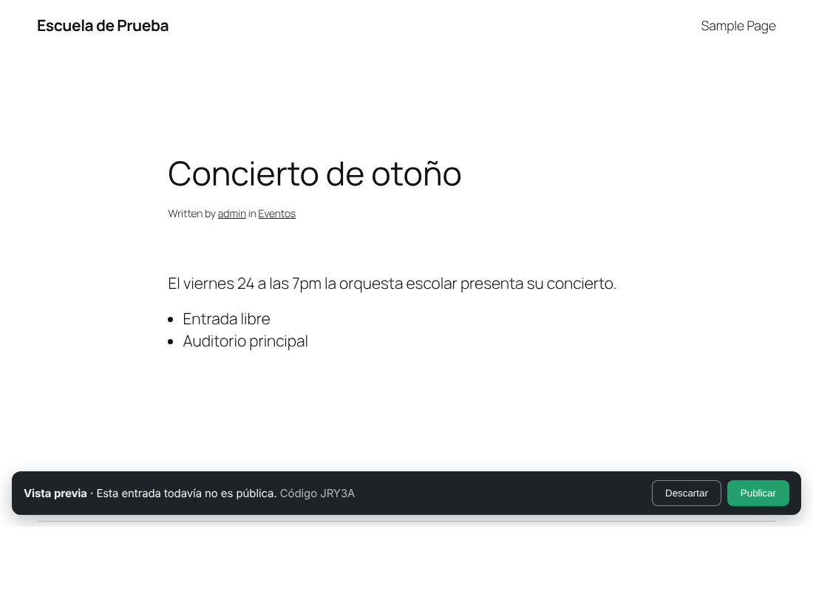

# CLETBOT

Plugin de WordPress para **publicar en el blog lo que le mandes por correo o WhatsApp**. Le envías un texto, un PDF, un Word o fotos e indicas la categoría. Claude (la IA de Anthropic) lo analiza y prepara la entrada. CLETBOT te responde con el **enlace a la vista previa** y **solo publica cuando contestas «SI»**.



## Cómo se usa

1. **Envía el material** al número de WhatsApp o al correo de CLETBOT. Al inicio del mensaje (o en el pie de foto del documento) puedes indicar:

   ```text
   Categoría: Noticias
   Título: Inauguramos el nuevo laboratorio      ← opcional
   Etiquetas: ciencia, campus                     ← opcional
   Notas: que sea breve y con tono formal         ← opcional, indicaciones para redactar

   Hoy abrimos el laboratorio de robótica…
   ```

   En el correo también funciona el asunto `[Noticias] Inauguramos el nuevo laboratorio`.

2. CLETBOT contesta *«📥 Recibido…»*. Unos segundos después manda la vista previa:

   ```text
   ✅ Listo, preparé esta entrada:
   *Feria de Ciencias 2026*
   Categoría: Eventos

   👀 Vista previa: https://tusitio.com/?cletbot_preview=…

   📝 No se indica la sede.

   ¿La publico? Responde:
   • *SI* para publicarla
   • *NO* para descartarla
   • *CAMBIOS: …* para pedir ajustes (p. ej. «CAMBIOS: hazla más corta»)
   • *CATEGORÍA: …* para cambiar la categoría

   Código: 28D67
   ```

3. **Responde** en el mismo chat o hilo de correo:

   | Respuesta | Qué hace |
   |---|---|
   | `SI` · `Sí, publícala` · `ok` · `publicar` | Publica la entrada y te manda el enlace definitivo. |
   | `NO` · `descartar` · `cancelar` | La manda a la papelera; no se publica nada. |
   | `CAMBIOS: pon la fecha en el título` | Claude rehace la entrada con tus indicaciones y te manda la vista previa actualizada (el enlace es el mismo). |
   | `Categoría: Eventos` | Cambia la categoría. |
   | `PENDIENTES` | Lista lo que falta aprobar. |
   | `AYUDA` | Explica cómo funciona. |

   Si tienes **varias entradas pendientes**, añade el código: `SI 28D67`. En el correo no hace falta, porque el código va en el asunto (`[CLETBOT #28D67]`). Cualquier otra respuesta a ese correo se toma como «cambios».

   La vista previa también tiene botones **Publicar** y **Descartar** (puedes desactivarlos en los ajustes).

### Qué hace con cada tipo de archivo

| Material | Qué hace |
|---|---|
| Texto del mensaje | Lo redacta como entrada. Sin IA, lo publica tal cual, con párrafos, listas y \*negritas\* de WhatsApp. |
| **PDF** | Se lo envía completo a Claude, que lee texto, tablas e imágenes. Sin IA, extrae el texto (con `pdftotext` si el servidor lo tiene). |
| **Word (.docx)**, OpenDocument (.odt) | Extrae el texto conservando subtítulos, negritas, listas y tablas. |
| Word antiguo (.doc), RTF, HTML, TXT | Extrae el texto. |
| **Fotos** (JPG, PNG, WebP) | La primera es la imagen destacada; las demás forman una galería. Claude también las ve para entender el contexto. |

Claude decide el formato que mejor funciona (noticia, comunicado, convocatoria…), escribe el título, el extracto, las etiquetas y la meta descripción SEO (compatible con Yoast y Rank Math) y **no inventa datos**: si falta algo importante, lo avisa en la nota 📝 del mensaje de vista previa. Si no indicas categoría, elige la más adecuada entre las que ya existen.

## Instalación

1. Copia la carpeta `cletbot` en `wp-content/plugins/` (o súbela como ZIP en *Plugins → Añadir nuevo*) y actívala.
2. Ve a **CLETBOT → Ajustes**.

Requisitos: WordPress 5.8+, PHP 7.4+ con `zip` y `dom`. Para leer un buzón por IMAP hace falta la extensión `imap` de PHP. Si no la tienes, usa el webhook de correo.

### 1. General

- **Remitentes autorizados**: uno por línea. Pueden ser correos (`ana@escuela.mx`), dominios completos (`@escuela.mx`) o números de WhatsApp con código de país (`+52 55 1234 5678`). **Los mensajes de cualquier otra persona se ignoran.**
- **Pueden aprobar además**: personas que pueden aprobar o descartar envíos ajenos (por ejemplo, quien dirige comunicación), aunque no envíen material.
- Categoría por defecto, autor de las entradas, días de validez de la vista previa, adjuntar el PDF original…

### 2. Inteligencia artificial

- **API key de Anthropic**: créala en [platform.claude.com](https://platform.claude.com/). También puedes definirla en `wp-config.php`:

  ```php
  define( 'CLETBOT_ANTHROPIC_API_KEY', 'sk-ant-…' );
  ```

- **Modelo**: `claude-opus-5-5` por defecto. `claude-sonnet-5-5` o `claude-haiku-5-5` cuestan menos.
- **Lineamientos editoriales**: el tono, la extensión, el público, las palabras que se usan o se evitan… Se aplican a todas las entradas.

Sin API key, CLETBOT funciona igual, pero publica el texto tal como llega y no puede aplicar «CAMBIOS».

### 3. Correo

Elige **una** de estas dos opciones:

- **Buzón IMAP** (lo más sencillo): crea un correo exclusivo, por ejemplo `blog@tudominio.com`, y escribe sus datos. CLETBOT lo revisa cada 5 minutos y marca como leídos los correos que procesa. Con Gmail, usa `imap.gmail.com:993` y una [contraseña de aplicación](https://myaccount.google.com/apppasswords).
- **Webhook de correo entrante**: en Mailgun (*Routes*), SendGrid (*Inbound Parse*) o Postmark (*Inbound*), apunta a la URL que aparece en los ajustes. Llega al instante y no necesita IMAP.

Las respuestas salen con `wp_mail()`, con *Reply-To* al buzón de CLETBOT, para que las contestaciones («SI», «NO»…) vuelvan a él. Si tu sitio tiene problemas para enviar correo, instala un plugin SMTP.

**Verificar remitente** (activado por defecto): solo acepta correos que el servidor receptor validó con DKIM o DMARC. Así nadie puede hacerse pasar por un remitente autorizado falsificando el campo «De».

### 4. WhatsApp (API Cloud de Meta)

1. En [developers.facebook.com/apps](https://developers.facebook.com/apps), crea una app de tipo *Business* y añade el producto **WhatsApp**.
2. Registra el número que usará CLETBOT y copia su **Phone number ID**.
3. Crea un **token permanente** (*Business Settings → Usuarios del sistema*, con el permiso `whatsapp_business_messaging`) y copia el **App secret** (*App settings → Basic*).
4. En *WhatsApp → Configuration → Webhook*, pega la **URL del webhook** y el **token de verificación** que muestra CLETBOT, y suscríbete al campo `messages`.
5. Escribe el Phone number ID, el token y el App secret en CLETBOT → Ajustes → WhatsApp.

Cada aviso del webhook se comprueba con la firma `X-Hub-Signature-256` (por eso el App secret es obligatorio). Los mensajes repetidos se descartan.

**Agrupar mensajes** (20 s por defecto): en WhatsApp es habitual mandar el PDF y luego otro mensaje con «Categoría: …». Lo que llega del mismo número en ese lapso se junta en una sola entrada.

### Tareas en segundo plano

CLETBOT prepara la entrada en segundo plano para que WhatsApp y el webhook reciban respuesta de inmediato. Con PHP-FPM (lo habitual) lo hace justo después de responder. En otros servidores usa WP-Cron, que depende de las visitas al sitio. Si tu sitio tiene poco tráfico, configura un cron real:

```cron
* * * * * curl -s https://tusitio.com/wp-cron.php?doing_wp_cron > /dev/null
```

## Panel

- **CLETBOT → Envíos**: todo lo que ha llegado, con su estado (*en cola*, *preparando*, *esperando aprobación*, *publicada*, *descartada*, *error*), quién lo envió, la entrada creada y su código. Desde aquí puedes **publicar**, **descartar** o **reintentar** un envío.
- **CLETBOT → Ajustes → Registro**: los últimos 200 eventos (mensajes ignorados, errores de la API, publicaciones…).

Las entradas se crean con estado **Pendiente de revisión**, así que también puedes editarlas desde *Entradas* antes de aprobarlas.

## Seguridad y privacidad

- Solo se procesan mensajes de **remitentes autorizados**. Los correos deben pasar DKIM o DMARC y los avisos de WhatsApp deben llevar la firma de Meta.
- Nada se publica sin una aprobación explícita: una respuesta «SI» de quien envió el material o de un aprobador, el botón de la vista previa o el panel.
- El enlace de vista previa lleva un token aleatorio de 32 caracteres. Caduca a los 7 días (configurable), no lo indexan los buscadores y deja de funcionar al publicar o descartar la entrada. Quien tenga el enlace puede ver la entrada y usar los botones: no lo reenvíes.
- Los botones de la vista previa funcionan con POST, así que los antivirus de correo y las vistas previas de enlaces de WhatsApp no pueden publicar por accidente.
- Los archivos recibidos se guardan temporalmente en `uploads/cletbot-tmp/` (bloqueado al acceso web) y se borran después de procesarse. Solo las fotos, y el documento si activas «Archivo original», pasan a la biblioteca de medios.
- Claude solo sigue las indicaciones de la persona (`Notas:`, `CAMBIOS:`). El contenido de los documentos se trata como material, no como instrucciones.
- El material se envía a la API de Anthropic para procesarlo. Consulta sus [políticas de datos](https://www.anthropic.com/legal/commercial-terms).

## Para desarrolladores

- Filtros: `cletbot_message` (texto de cada respuesta), `cletbot_whatsapp_recipient` (número de destino), `cletbot_ai_timeout` (segundos, 300 por defecto) y `cletbot_delete_data_on_uninstall`.
- Pruebas unitarias, sin WordPress: `php cletbot/tests/run-tests.php`.
- Las llamadas a Claude usan la API de Mensajes mediante la API HTTP de WordPress (sin Composer), con salida estructurada (`output_config.format` con JSON Schema). Si los filtros de seguridad del modelo rechazan una petición, se reintenta automáticamente con otro modelo (`fallbacks: "default"`); puedes desactivarlo en los ajustes.
- Al desinstalar se borran los ajustes, el registro y los envíos. Las entradas del blog se conservan.
