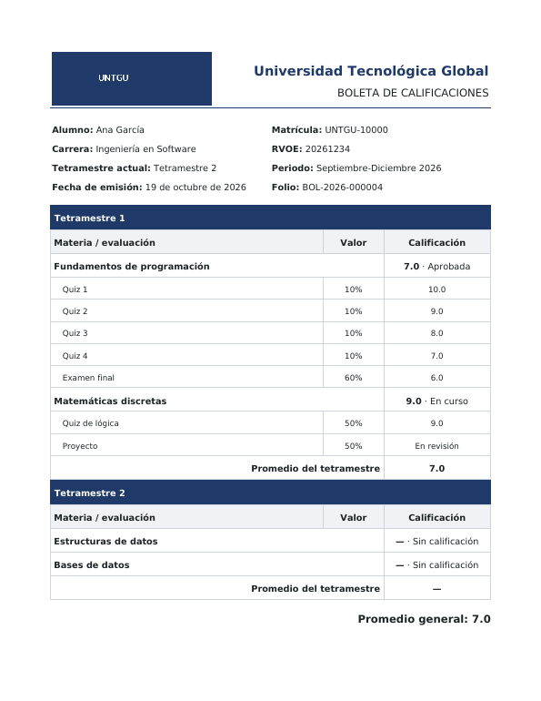
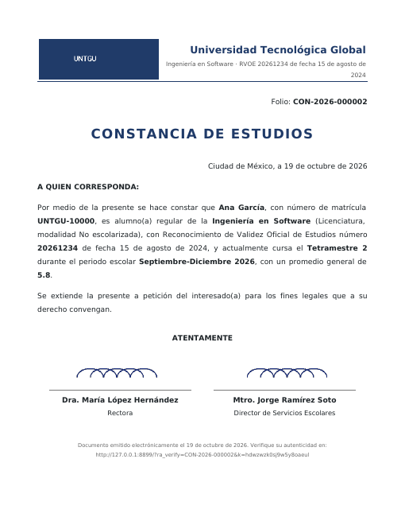
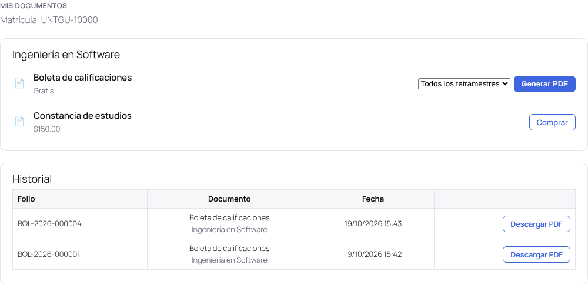

# Retícula Académica

Plugin de WordPress para **Tutor LMS** que organiza los cursos en **carreras** y **tetramestres**. El alumno se inscribe a una carrera, paga sus cuotas con el checkout de Tutor, ve en todo momento **qué curso sigue y en qué punto está**, y avanza de tetramestre automáticamente.

Además asigna **matrícula consecutiva** (UNTGU-10000, UNTGU-10001…), calcula **calificaciones ponderadas** por materia a partir de los quizzes y genera **boletas y constancias en PDF** con plantillas, dos firmas, folio, verificación pública e historial. Las constancias pueden venderse: cada tipo crea su producto automáticamente.


## Cómo funciona

```text
Carrera (p. ej. Ingeniería en Software)
├── Cuota de inscripción  → un curso de pago de Tutor (opcional)
├── Tetramestre 1
│   ├── Cuota del tetramestre → curso de pago de Tutor (opcional, p. ej. reinscripción)
│   ├── 1. Fundamentos de programación   (curso de Tutor)
│   └── 2. Matemáticas discretas         (curso de Tutor)
├── Tetramestre 2
│   └── …
└── Tetramestre 3
```

- **Carrera** = grupo de tetramestres. Tiene una página pública con su retícula y el botón *Inscribirme a esta carrera*.
- **Tetramestre** = grupo ordenado de cursos de Tutor. El orden es la ruta que verá el alumno.
- **Inscripción** = alumno + carrera, con tetramestre de inicio, tetramestre actual y estado (*pago pendiente*, *activo*, *pausado*, *baja*, *egresado*).

### Las cuotas se cobran con Tutor

El plugin **no tiene pasarela de pago propia**: cada cuota es un curso de Tutor con precio (por ejemplo, un curso oculto *«Inscripción Ingeniería en Software»*). Así funciona con cualquier método de cobro que tengas configurado en Tutor (monetización nativa, WooCommerce o EDD) y las cuotas aparecen en los pedidos e informes de Tutor.

- **Inscripción**: cuando el alumno compra la cuota, su inscripción pasa de *pago pendiente* a *activa*.
- **Cuota por tetramestre** (opcional): los cursos de ese tetramestre siguen bloqueados hasta que la paga.
- **Cada curso** se paga y matricula como siempre en Tutor. Hasta que lo compra, el alumno ve el curso en su retícula con el precio y el botón *Inscribirme*, pero no está matriculado.

### Orden de los cursos (por carrera)

| Modo | Qué puede comprar el alumno |
| --- | --- |
| **Solo recomendado** | Cualquier curso de su carrera; el orden es una guía. |
| **Por tetramestre** *(por defecto)* | Cursos de su tetramestre actual o anteriores; los futuros están bloqueados. |
| **Estricto** | Solo el siguiente curso; tiene que terminar el anterior para desbloquear el siguiente. |

El bloqueo se aplica en Tutor con los filtros `tutor_can_purchase_course` (carrito) y `tutor_allow_course_enrollment` (matrícula), y el alumno ve el motivo. Los cursos que no pertenecen a su carrera no se restringen, y los administradores nunca quedan bloqueados.

## Lo que ve el alumno (autoservicio)

- **Catálogo** con el shortcode `[reticula_carreras]` y página de cada carrera en `/carrera/<nombre>/` (archivo en `/carreras/`).
- **Inscribirse** solo, con un clic. Si hay cuota de inscripción, va directo a pagarla.
- **Pestaña «Mi carrera»** en el panel de Tutor (`/dashboard/mi-carrera/`), también disponible con `[reticula_mi_carrera]`:
  - **Tu siguiente paso**: pagar inscripción, pagar la cuota del tetramestre, inscribirse al siguiente curso (con precio) o continuar el que está cursando.
  - Avance total (% y cursos completados) y línea de tiempo por tetramestre: completado, en curso, próximo, acreditado.
  - Cada curso con su estado: completado, en curso (con % de avance), disponible (precio + *Inscribirme*) o bloqueado (con el motivo).
- **En la página de cada curso**: «Ingeniería en Software · Tetramestre 2 · Curso 1 de 2», el motivo si está bloqueado, o «Completaste este curso. Sigue: …».
- **Avance automático**: al completar todos los cursos del tetramestre pasa al siguiente; al terminar el último queda como *egresado*.

## Lo que hace el administrador

Menú **Retícula**:

1. **Carreras** → crear la carrera, elegir la cuota de inscripción, el modo de orden y si los alumnos pueden inscribirse solos.
2. **Tetramestres** → desde la carrera, *Añadir tetramestre*: número, cuota opcional y cursos (lista con arrastrar y soltar).
3. **Alumnos**:
   - Asignar un alumno a una carrera y al tetramestre en el que **inicia**. Los anteriores cuentan como *acreditados* (revalidación). El estado puede ser *Automático* (pendiente hasta pagar) o *Activo* (sin cobrar la inscripción, útil para becas).
   - Importar alumnos por **CSV**: `alumno,carrera,tetramestre,estado`, con separador `,` o `;`.
   - Listado con filtros por carrera, tetramestre y estado, % de avance y siguiente curso. Exportación a CSV.
   - Editar una inscripción (estado, tetramestre de inicio y actual, notas) viendo **lo mismo que ve el alumno**.

## Matrícula

- Formato **prefijo + número consecutivo**, por defecto `UNTGU-10000`, `UNTGU-10001`… (*Retícula → Ajustes → Matrícula*: prefijo, número inicial y cuándo se asigna).
- Se asigna **al inscribirse a una carrera** (por defecto) o **al registrarse** cualquier usuario. Nunca se repite: el número se reserva en una tabla con índice único.
- Se ve en el **perfil del usuario** (editable por el administrador, valida que no esté repetida), en la lista de **Usuarios**, en **Alumnos** (columna y búsqueda), en la exportación CSV, en *Mi carrera*, *Mis documentos* y en los documentos (`{matricula}`).
- Para alumnos que ya existían: *Ajustes → Asignar matrículas faltantes* (respeta el orden de inscripción).

## Calificaciones (lo que alimenta la boleta)

- La calificación de cada materia es el **promedio ponderado de sus quizzes de Tutor**. Por defecto todos valen lo mismo (5 quizzes = 20% cada uno).
- *Retícula → Evaluación*: elige la materia y asigna el valor de cada evaluación (p. ej. 4 quizzes de 10% y examen final de 60%). El total se muestra en vivo; si no suma 100% se normaliza.
- Cuenta el **mejor intento** o el **último** (ajuste). Un quiz **en revisión** (preguntas abiertas) no cuenta como cero: la materia queda *En curso* hasta que el profesor lo califica. Un quiz no presentado cuenta como 0 cuando el curso ya está terminado.
- Opcional: las lecciones **SCORM** (plugin Tutor SCORM) pueden entrar en la ponderación.
- Escala 0–10 o 0–100, calificación mínima aprobatoria (7 por defecto) y decimales en *Ajustes*.
- El alumno ve la calificación y el desglose en *Mi carrera* (por materia) y en la página de cada curso.

## Documentos: boletas y constancias en PDF

### Configuración (una vez)

1. *Retícula → Ajustes*: nombre de la institución, **logo**, **ciudad**, **dos firmas** (nombre, cargo e imagen de la firma) y **periodos escolares** (`Septiembre-Diciembre 2026 | 2026-09-01 | 2026-12-31`).
2. En cada **carrera**, el cuadro *Datos oficiales (RVOE)*: número y fecha de RVOE, clave, nivel y modalidad.
3. *Retícula → Plantillas de documentos*: se crean dos plantillas de ejemplo (*Constancia de estudios* y *Boleta de calificaciones*) en borrador. Edítalas y publícalas.

### Plantillas

- El contenido es HTML (editor clásico) con campos entre llaves que se reemplazan al generar el PDF: `{alumno}`, `{matricula}`, `{carrera}`, `{rvoe}`, `{rvoe_fecha}`, `{tetramestre}`, `{tetramestre_ordinal}`, `{periodo}`, `{promedio_general}`, `{tabla_calificaciones}`, `{fecha_emision}`, `{lugar_fecha}`, `{firmas}`, `{firma_1}`, `{firma_2}`, `{folio}`, `{verificacion_url}`… (la lista completa aparece en la pantalla de la plantilla).
- Ajustes por plantilla: tipo (constancia/boleta), **precio**, prefijo del folio, papel (carta, A4, oficio) y orientación, margen, **imagen de fondo** (hoja membretada) y carreras en las que está disponible.
- **Vista previa PDF** con los datos del alumno más reciente.
- La **fecha de emisión se genera automáticamente** al momento de crear el documento.

### Constancias de pago

- Si la plantilla tiene **precio**, se crea automáticamente su **producto de venta** (un curso de Tutor oculto del catálogo; con WooCommerce como método de cobro también se crea el producto de Woo).
- El alumno pulsa *Comprar*, paga con el checkout de Tutor y vuelve a *Mis documentos*, donde aparece *Pagado · listo para generar*. Cada compra da derecho a **un** documento; después puede volver a comprarlo.
- Solo pueden comprarla alumnos con inscripción activa.

 

### Lo que hace el alumno



Pestaña **Mis documentos** en el panel de Tutor (o shortcode `[reticula_documentos]`):

- **Generar PDF**: la boleta (gratis; puede elegir *todos los tetramestres* o uno) o la constancia ya pagada. El PDF se descarga al momento.
- **Historial**: todos sus documentos con folio y fecha, para **volver a descargarlos** cuando quiera (se guarda el PDF original).

### Historial, verificación y control

- *Retícula → Documentos emitidos*: todos los documentos con folio, alumno, matrícula, origen (gratis, compra o personal), fecha y estado. Se puede filtrar, buscar por folio, alumno o matrícula, descargar, **verificar** y **revocar**.
- El personal puede **emitir documentos sin cobro** para cualquier alumno (también desde la ficha del alumno).
- Cada PDF lleva un **enlace público de verificación** (`{verificacion_url}`) que muestra si el folio es válido; si se revoca, deja de serlo.
- Los PDF se guardan en `wp-content/uploads/ra-documentos/` (protegido con `.htaccess`; en Nginx conviene bloquear esa carpeta). Solo el alumno dueño y el personal pueden descargarlos.
- Los PDF se generan con [dompdf](https://github.com/dompdf/dompdf) (incluido en `vendor/`, licencia LGPL).

## Shortcodes

| Shortcode | Uso |
| --- | --- |
| `[reticula_carreras]` | Catálogo de carreras. |
| `[reticula_carrera id="123"]` | Retícula de una carrera con botón de inscripción (o el avance si el alumno ya está inscrito). |
| `[reticula_mi_carrera]` | Avance del alumno en sus carreras (`program="123"` para mostrar solo una). |
| `[reticula_documentos]` | Mis documentos: generar boleta/constancia y su historial. |

## Hooks

| Hook | Tipo | Cuándo |
| --- | --- | --- |
| `ra_inscription_saved` | acción | Al crear o actualizar una inscripción. |
| `ra_inscription_activated` | acción | Al pagar la inscripción (pendiente → activa). |
| `ra_term_changed` | acción | Cuando el alumno avanza de tetramestre. |
| `ra_program_completed` | acción | Cuando termina la carrera (egresado). |
| `ra_progress` | filtro | Ajustar el cálculo de avance. |
| `ra_course_lock` | filtro | Ajustar o anular un bloqueo de curso. |
| `ra_manage_capability` | filtro | Capacidad para administrar (por defecto `manage_options`). |
| `ra_my_program_url` | filtro | URL de «Mi carrera». |
| `ra_student_id_assigned` | acción | Al asignar una matrícula. |
| `ra_course_grade` | filtro | Ajustar la calificación calculada de una materia. |
| `ra_document_vars` | filtro | Añadir o cambiar campos de las plantillas. |
| `ra_document_purchased` | acción | Cuando se paga un documento. |
| `ra_document_issued` | acción | Cuando se genera un documento (p. ej. para enviarlo por correo). |

Con estos hooks puedes, por ejemplo, enviar un correo cuando el alumno cambia de tetramestre o emitir una constancia al egresar.

## Requisitos e instalación

- WordPress 5.8+, PHP 7.4+, Tutor LMS (probado con Tutor LMS 4.1.1).
- Sube `reticula-academica.zip` en *Plugins → Añadir nuevo*, actívalo y ve a **Retícula**.
- Si la pestaña *Mi carrera* da 404, guarda una vez *Ajustes → Enlaces permanentes*.

## Pruebas

```bash
php tests/run-tests.php   # avance (bloqueos, cuotas, orden, egreso), calificaciones ponderadas y plantillas
```
