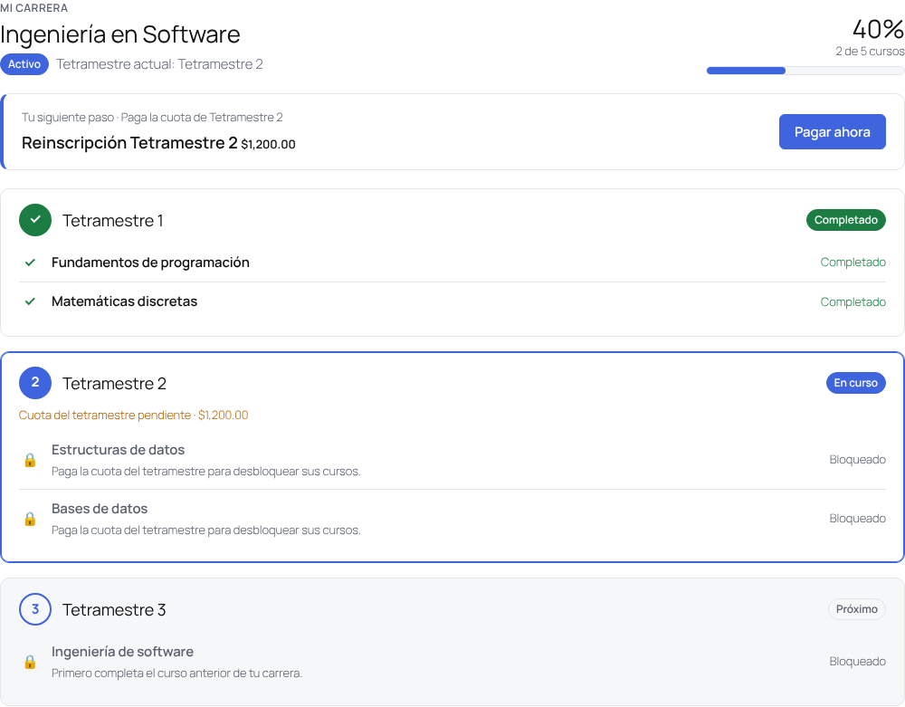

# Retícula Académica

Plugin de WordPress para **Tutor LMS** que organiza los cursos en **carreras** y **tetramestres**. El alumno se inscribe a una carrera, paga sus cuotas con el checkout de Tutor, ve en todo momento **qué curso sigue y en qué punto está**, y avanza de tetramestre automáticamente.



## Cómo funciona

```text
Carrera (p. ej. Ingeniería en Software)
├── Cuota de inscripción  → un curso de pago de Tutor (opcional)
├── Tetramestre 1
│   ├── Cuota del tetramestre → curso de pago de Tutor (opcional, p. ej. reinscripción)
│   ├── 1. Fundamentos de programación   (curso de Tutor)
│   └── 2. Matemáticas discretas         (curso de Tutor)
├── Tetramestre 2
│   └── …
└── Tetramestre 3
```

- **Carrera** = grupo de tetramestres. Tiene una página pública con su retícula y el botón *Inscribirme a esta carrera*.
- **Tetramestre** = grupo ordenado de cursos de Tutor. El orden es la ruta que verá el alumno.
- **Inscripción** = alumno + carrera, con tetramestre de inicio, tetramestre actual y estado (*pago pendiente*, *activo*, *pausado*, *baja*, *egresado*).

### Las cuotas se cobran con Tutor

El plugin **no tiene pasarela de pago propia**: cada cuota es un curso de Tutor con precio (por ejemplo, un curso oculto *«Inscripción Ingeniería en Software»*). Así funciona con cualquier método de cobro que tengas configurado en Tutor (monetización nativa, WooCommerce o EDD) y las cuotas aparecen en los pedidos e informes de Tutor.

- **Inscripción**: cuando el alumno compra la cuota, su inscripción pasa de *pago pendiente* a *activa*.
- **Cuota por tetramestre** (opcional): los cursos de ese tetramestre siguen bloqueados hasta que la paga.
- **Cada curso** se paga y matricula como siempre en Tutor. Hasta que lo compra, el alumno ve el curso en su retícula con el precio y el botón *Inscribirme*, pero no está matriculado.

### Orden de los cursos (por carrera)

| Modo | Qué puede comprar el alumno |
| --- | --- |
| **Solo recomendado** | Cualquier curso de su carrera; el orden es una guía. |
| **Por tetramestre** *(por defecto)* | Cursos de su tetramestre actual o anteriores; los futuros están bloqueados. |
| **Estricto** | Solo el siguiente curso; tiene que terminar el anterior para desbloquear el siguiente. |

El bloqueo se aplica en Tutor con los filtros `tutor_can_purchase_course` (carrito) y `tutor_allow_course_enrollment` (matrícula), y el alumno ve el motivo. Los cursos que no pertenecen a su carrera no se restringen, y los administradores nunca quedan bloqueados.

## Lo que ve el alumno (autoservicio)

- **Catálogo** con el shortcode `[reticula_carreras]` y página de cada carrera en `/carrera/<nombre>/` (archivo en `/carreras/`).
- **Inscribirse** solo, con un clic. Si hay cuota de inscripción, va directo a pagarla.
- **Pestaña «Mi carrera»** en el panel de Tutor (`/dashboard/mi-carrera/`), también disponible con `[reticula_mi_carrera]`:
  - **Tu siguiente paso**: pagar inscripción, pagar la cuota del tetramestre, inscribirse al siguiente curso (con precio) o continuar el que está cursando.
  - Avance total (% y cursos completados) y línea de tiempo por tetramestre: completado, en curso, próximo, acreditado.
  - Cada curso con su estado: completado, en curso (con % de avance), disponible (precio + *Inscribirme*) o bloqueado (con el motivo).
- **En la página de cada curso**: «Ingeniería en Software · Tetramestre 2 · Curso 1 de 2», el motivo si está bloqueado, o «Completaste este curso. Sigue: …».
- **Avance automático**: al completar todos los cursos del tetramestre pasa al siguiente; al terminar el último queda como *egresado*.

## Lo que hace el administrador

Menú **Retícula**:

1. **Carreras** → crear la carrera, elegir la cuota de inscripción, el modo de orden y si los alumnos pueden inscribirse solos.
2. **Tetramestres** → desde la carrera, *Añadir tetramestre*: número, cuota opcional y cursos (lista con arrastrar y soltar).
3. **Alumnos**:
   - Asignar un alumno a una carrera y al tetramestre en el que **inicia**. Los anteriores cuentan como *acreditados* (revalidación). El estado puede ser *Automático* (pendiente hasta pagar) o *Activo* (sin cobrar la inscripción, útil para becas).
   - Importar alumnos por **CSV**: `alumno,carrera,tetramestre,estado`, con separador `,` o `;`.
   - Listado con filtros por carrera, tetramestre y estado, % de avance y siguiente curso. Exportación a CSV.
   - Editar una inscripción (estado, tetramestre de inicio y actual, notas) viendo **lo mismo que ve el alumno**.

## Shortcodes

| Shortcode | Uso |
| --- | --- |
| `[reticula_carreras]` | Catálogo de carreras. |
| `[reticula_carrera id="123"]` | Retícula de una carrera con botón de inscripción (o el avance si el alumno ya está inscrito). |
| `[reticula_mi_carrera]` | Avance del alumno en sus carreras (`program="123"` para mostrar solo una). |

## Hooks

| Hook | Tipo | Cuándo |
| --- | --- | --- |
| `ra_inscription_saved` | acción | Al crear o actualizar una inscripción. |
| `ra_inscription_activated` | acción | Al pagar la inscripción (pendiente → activa). |
| `ra_term_changed` | acción | Cuando el alumno avanza de tetramestre. |
| `ra_program_completed` | acción | Cuando termina la carrera (egresado). |
| `ra_progress` | filtro | Ajustar el cálculo de avance. |
| `ra_course_lock` | filtro | Ajustar o anular un bloqueo de curso. |
| `ra_manage_capability` | filtro | Capacidad para administrar (por defecto `manage_options`). |
| `ra_my_program_url` | filtro | URL de «Mi carrera». |

Con estos hooks puedes, por ejemplo, enviar un correo cuando el alumno cambia de tetramestre o emitir una constancia al egresar.

## Requisitos e instalación

- WordPress 5.8+, PHP 7.4+, Tutor LMS (probado con Tutor LMS 4.1.1).
- Sube `reticula-academica.zip` en *Plugins → Añadir nuevo*, actívalo y ve a **Retícula**.
- Si la pestaña *Mi carrera* da 404, guarda una vez *Ajustes → Enlaces permanentes*.

## Pruebas

```bash
php tests/run-tests.php   # motor de avance: bloqueos, cuotas, orden, avance de tetramestre, egreso
```
