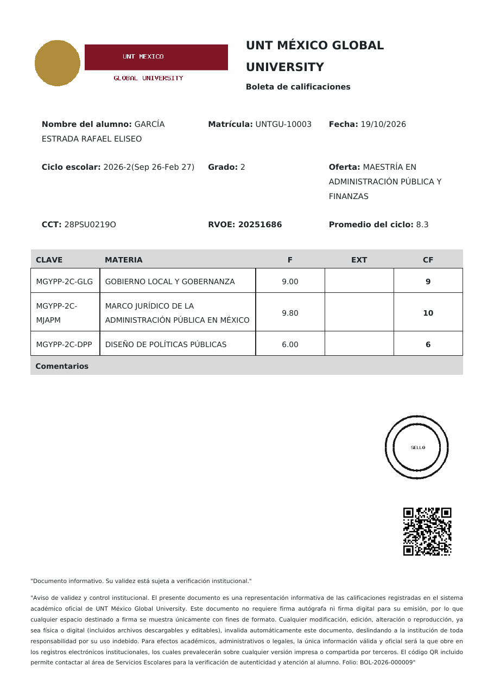

# Retícula Académica

Plugin de WordPress para **Tutor LMS** que organiza los cursos en **carreras** y **tetramestres**. El alumno se inscribe a una carrera, paga sus cuotas con el checkout de Tutor, ve en todo momento **qué curso sigue y en qué punto está**, y avanza de tetramestre automáticamente.

Además asigna **matrícula consecutiva** (UNTGU-10000, UNTGU-10001…), calcula **calificaciones ponderadas** por materia a partir de los quizzes y genera **boletas y constancias en PDF** con plantillas, dos firmas, folio, verificación pública e historial. Las constancias pueden venderse: cada tipo crea su producto automáticamente.


## Cómo funciona

```text
Carrera (p. ej. Ingeniería en Software)
├── Cuota de inscripción  → un curso de pago de Tutor (opcional)
├── Tetramestre 1
│   ├── Cuota del tetramestre → curso de pago de Tutor (opcional, p. ej. reinscripción)
│   ├── 1. Fundamentos de programación   (curso de Tutor)
│   └── 2. Matemáticas discretas         (curso de Tutor)
├── Tetramestre 2
│   └── …
└── Tetramestre 3
```

- **Carrera** = grupo de tetramestres. Tiene una página pública con su retícula y el botón *Inscribirme a esta carrera*.
- **Tetramestre** = grupo ordenado de cursos de Tutor. El orden es la ruta que verá el alumno.
- **Inscripción** = alumno + carrera, con tetramestre de inicio, tetramestre actual y estado (*pago pendiente*, *activo*, *pausado*, *baja*, *egresado*).

### Las cuotas se cobran con Tutor

El plugin **no tiene pasarela de pago propia**: cada cuota es un curso de Tutor con precio (por ejemplo, un curso oculto *«Inscripción Ingeniería en Software»*). Así funciona con cualquier método de cobro que tengas configurado en Tutor (monetización nativa, WooCommerce o EDD) y las cuotas aparecen en los pedidos e informes de Tutor.

- **Inscripción**: cuando el alumno compra la cuota, su inscripción pasa de *pago pendiente* a *activa*.
- **Cuota por tetramestre** (opcional): los cursos de ese tetramestre siguen bloqueados hasta que la paga.
- **Cada curso** se paga y matricula como siempre en Tutor. Hasta que lo compra, el alumno ve el curso en su retícula con el precio y el botón *Inscribirme*, pero no está matriculado.

### Orden de los cursos (por carrera)

| Modo | Qué puede comprar el alumno |
| --- | --- |
| **Solo recomendado** | Cualquier curso de su carrera; el orden es una guía. |
| **Por tetramestre** *(por defecto)* | Cursos de su tetramestre actual o anteriores; los futuros están bloqueados. |
| **Estricto** | Solo el siguiente curso; tiene que terminar el anterior para desbloquear el siguiente. |

El bloqueo se aplica en Tutor con los filtros `tutor_can_purchase_course` (carrito) y `tutor_allow_course_enrollment` (matrícula), y el alumno ve el motivo. Los cursos que no pertenecen a su carrera no se restringen, y los administradores nunca quedan bloqueados.

## Lo que ve el alumno (autoservicio)

- **Catálogo** con el shortcode `[reticula_carreras]` y página de cada carrera en `/carrera/<nombre>/` (archivo en `/carreras/`).
- **Inscribirse** solo, con un clic. Si hay cuota de inscripción, va directo a pagarla.
- **Pestaña «Mi carrera»** en el panel de Tutor (`/dashboard/mi-carrera/`), también disponible con `[reticula_mi_carrera]`:
  - **Tu siguiente paso**: pagar inscripción, pagar la cuota del tetramestre, inscribirse al siguiente curso (con precio) o continuar el que está cursando.
  - Avance total (% y cursos completados) y línea de tiempo por tetramestre: completado, en curso, próximo, acreditado.
  - Cada curso con su estado: completado, en curso (con % de avance), disponible (precio + *Inscribirme*) o bloqueado (con el motivo).
- **En la página de cada curso**: «Ingeniería en Software · Tetramestre 2 · Curso 1 de 2», el motivo si está bloqueado, o «Completaste este curso. Sigue: …».
- **Avance automático**: al completar todos los cursos del tetramestre pasa al siguiente; al terminar el último queda como *egresado*.

## Lo que hace el administrador

Menú **Retícula**:

1. **Carreras** → crear la carrera, elegir la cuota de inscripción, el modo de orden y si los alumnos pueden inscribirse solos.
2. **Tetramestres** → desde la carrera, *Añadir tetramestre*: número, cuota opcional y cursos (lista con arrastrar y soltar). Cada materia lleva su **clave** (p. ej. `MGYPP-2C-GLG`), que se captura en esa misma lista y se imprime en las boletas.
3. **Alumnos**:
   - Asignar un alumno a una carrera y al tetramestre en el que **inicia**. Los anteriores cuentan como *acreditados* (revalidación). El estado puede ser *Automático* (pendiente hasta pagar) o *Activo* (sin cobrar la inscripción, útil para becas).
   - Importar alumnos por **CSV**: `alumno,carrera,tetramestre,estado`, con separador `,` o `;`.
   - Listado con filtros por carrera, tetramestre y estado, % de avance y siguiente curso. Exportación a CSV.
   - Editar una inscripción (estado, tetramestre de inicio y actual, notas) viendo **lo mismo que ve el alumno**.

## Matrícula

- Formato **prefijo + número consecutivo**, por defecto `UNTGU-10000`, `UNTGU-10001`… (*Retícula → Ajustes → Matrícula*: prefijo, número inicial y cuándo se asigna).
- Se asigna **al inscribirse a una carrera** (por defecto) o **al registrarse** cualquier usuario. Nunca se repite: el número se reserva en una tabla con índice único.
- Se ve en el **perfil del usuario** (editable por el administrador, valida que no esté repetida), en la lista de **Usuarios**, en **Alumnos** (columna y búsqueda), en la exportación CSV, en *Mi carrera*, *Mis documentos* y en los documentos (`{matricula}`).
- Para alumnos que ya existían: *Ajustes → Asignar matrículas faltantes* (respeta el orden de inscripción).

## Calificaciones (lo que alimenta la boleta)

- La calificación de cada materia es el **promedio ponderado de sus quizzes de Tutor**. Por defecto todos valen lo mismo (5 quizzes = 20% cada uno).
- *Retícula → Evaluación*: elige la materia y asigna el valor de cada evaluación (p. ej. 4 quizzes de 10% y examen final de 60%). El total se muestra en vivo; si no suma 100% se normaliza.
- Cuenta el **mejor intento** o el **último** (ajuste). Un quiz **en revisión** (preguntas abiertas) no cuenta como cero: la materia queda *En curso* hasta que el profesor lo califica. Un quiz no presentado cuenta como 0 cuando el curso ya está terminado.
- Opcional: las lecciones **SCORM** (plugin Tutor SCORM) pueden entrar en la ponderación.
- Escala 0–10 o 0–100, calificación mínima aprobatoria (7 por defecto) y decimales en *Ajustes*.
- El alumno ve la calificación y el desglose en *Mi carrera* (por materia) y en la página de cada curso. En *Ajustes* se puede ocultar el desglose para mostrar solo la calificación final de cada materia.
- **Extraordinarios (EXT):** en la ficha del alumno (*Alumnos → Editar*) el personal captura la calificación extraordinaria de cualquier materia; sustituye a la ordinaria.
- **F, EXT y CF:** F es la calificación ordinaria (promedio ponderado, 2 decimales), EXT la extraordinaria y **CF la calificación final entera**: las aprobatorias se redondean (9.8 → 10) y las reprobatorias se truncan para que el redondeo nunca apruebe (6.8 → 6 si se aprueba con 7).
- **Promedio del ciclo** (`{promedio_ciclo}`): promedio del tetramestre de la boleta (el actual o el elegido al generarla). **Promedio general** (`{promedio_general}`): toda la carrera.

## Documentos: boletas y constancias en PDF

### Configuración (una vez)

1. *Retícula → Ajustes*: nombre de la institución, **logo**, **ciudad**, **dos firmas** (nombre, cargo e imagen de la firma) y **periodos escolares** (`Septiembre-Diciembre 2026 | 2026-09-01 | 2026-12-31`).
   También: **CCT**, **sello institucional** (imagen) y **enlace del código QR** (por ejemplo `https://wa.me/52155…?text=Verificar%20{folio}` para que el QR abra WhatsApp de Servicios Escolares con el folio; vacío = página de verificación del documento).
2. En cada **carrera**, el cuadro *Datos oficiales (RVOE)*: número y fecha de RVOE, clave, CCT, nivel y modalidad. El listado de carreras muestra la columna RVOE.
3. *Retícula → Plantillas de documentos*: se crean plantillas de ejemplo en borrador (*Constancia de estudios*, *Boleta de calificaciones* y **Boleta oficial**). Edítalas y publícalas.

### Boleta oficial



Reproduce el formato institucional: logo y nombre de la universidad, *Nombre del alumno* (mayúsculas, apellidos primero), *Matrícula*, *Fecha*, *Ciclo escolar*, *Grado*, *Oferta*, *CCT*, *RVOE* y *Promedio del ciclo*; tabla **CLAVE | MATERIA | F | EXT | CF** del ciclo; *Comentarios* (los escribe el personal al emitirla); sello, código QR y avisos legales al pie. Hoja A4, una página.

### Plantillas

- El contenido es HTML (editor clásico) con campos entre llaves que se reemplazan al generar el PDF: `{alumno}`, `{matricula}`, `{carrera}`, `{rvoe}`, `{rvoe_fecha}`, `{tetramestre}`, `{tetramestre_ordinal}`, `{periodo}`, `{promedio_general}`, `{tabla_calificaciones}`, `{fecha_emision}`, `{lugar_fecha}`, `{firmas}`, `{firma_1}`, `{firma_2}`, `{folio}`, `{verificacion_url}`… (la lista completa aparece en la pantalla de la plantilla).
- Ajustes por plantilla: tipo (constancia/boleta), **precio**, prefijo del folio, papel (carta, A4, oficio) y orientación, margen, **imagen de fondo** (hoja membretada), carreras en las que está disponible, **logo y nombre de la universidad propios** (si se dejan vacíos se usan los de Ajustes) y **mostrar o no los quizzes** en la tabla de calificaciones (sin quizzes, cada materia muestra solo su calificación final).
- Campos adicionales: `{tabla_boleta}` (CLAVE, MATERIA, F, EXT, CF), `{promedio_ciclo}`, `{alumno_mayusculas}`, `{oferta}`, `{grado}`, `{ciclo_escolar}`, `{cct}`, `{sello}`, `{qr}`, `{comentarios}`.
- **Vista previa PDF** con los datos del alumno más reciente.
- La **fecha de emisión se genera automáticamente** al momento de crear el documento.

### Constancias de pago

- Si la plantilla tiene **precio**, se crea automáticamente su **producto de venta** (un curso de Tutor oculto del catálogo; con WooCommerce como método de cobro también se crea el producto de Woo).
- El alumno pulsa *Comprar*, paga con el checkout de Tutor y vuelve a *Mis documentos*, donde aparece *Pagado · listo para generar*. Cada compra da derecho a **un** documento; después puede volver a comprarlo.
- Solo pueden comprarla alumnos con inscripción activa.

 

### Lo que hace el alumno


Pestaña **Mis documentos** en el panel de Tutor (o shortcode `[reticula_documentos]`):

- **Generar PDF**: la boleta (gratis; puede elegir *todos los tetramestres* o uno) o la constancia ya pagada. El PDF se descarga al momento.
- **Historial**: todos sus documentos con folio y fecha, para **volver a descargarlos** cuando quiera (se guarda el PDF original).

### Historial, verificación y control

- *Retícula → Documentos emitidos*: todos los documentos con folio, alumno, matrícula, origen (gratis, compra o personal), fecha y estado. Se puede filtrar, buscar por folio, alumno o matrícula, descargar, **verificar** y **revocar**.
- El personal puede **emitir documentos sin cobro** para cualquier alumno (también desde la ficha del alumno).
- Cada PDF lleva un **enlace público de verificación** (`{verificacion_url}`) que muestra si el folio es válido; si se revoca, deja de serlo.
- Los PDF se guardan en `wp-content/uploads/ra-documentos/` (protegido con `.htaccess`; en Nginx conviene bloquear esa carpeta). Solo el alumno dueño y el personal pueden descargarlos.
- Los PDF se generan con [dompdf](https://github.com/dompdf/dompdf) (licencia LGPL) y los códigos QR con [php-qrcode](https://github.com/chillerlan/php-qrcode) (licencia MIT), ambos incluidos en `vendor/`.

## Inscripción, datos generales y colegiaturas

### El recorrido del alumno nuevo
1. **Paga la inscripción y crea su cuenta.** En la página pública de la carrera, **Inscribirme** lo lleva directo al pago de WooCommerce. Ahí paga la cuota de inscripción y crea su usuario en el mismo paso. Al confirmarse el pago:
   - queda inscrito en esa carrera y activo;
   - recibe su matrícula;
   - empieza su calendario de colegiaturas.
2. **Datos generales.** La primera vez que entra a su panel se le piden sus datos generales en la pestaña **Mis datos**. Hasta completarlos no puede usar el panel ni las lecciones, pero sí ver y pagar sus colegiaturas. La lista de campos se edita en *Retícula → Ajustes → Datos generales del alumno*:
   - Viene precargada con nombre, apellidos, CURP (validada), fecha de nacimiento, sexo, teléfono, dirección, escuela de procedencia y contacto de emergencia.
   - Se pueden agregar, quitar o marcar como obligatorios.
   - Cada campo se puede usar en las plantillas de documentos como `{clave}`, por ejemplo `{curp}` o `{fecha_nacimiento}`.
3. **Documentos.** Después se le invita a subir su **expediente**. Es opcional en ese momento: puede pasar a *Mi carrera* y empezar sus cursos sin ellos (los recordatorios del expediente siguen funcionando).

### Colegiaturas
- **Cuánto y cuántos meses:** en cada **tetramestre** se capturan los **meses de colegiatura** y la **colegiatura mensual** (p. ej. 4 × $2,500). Otro tetramestre puede tener otro monto.
- **Fechas de pago:**
  - Si el alumno se inscribe **hasta el día 15** (día de corte, configurable), paga **ese mismo día** cada mes, empezando de inmediato. Si se inscribe el 13 de enero, paga el 13 de enero, 13 de febrero, 13 de marzo y 13 de abril.
  - Si se inscribe **del 16 en adelante**, paga el **día 1** de cada mes, empezando el mes siguiente. Si se inscribe el 26 de enero, paga el 1 de febrero, 1 de marzo, etc.
- **Continuidad:** el siguiente tetramestre sigue cobrando **sin pausa**, al mes siguiente del último pago y con su propio monto.
- **Tolerancia y recargo:**
  - Hay **5 días de tolerancia** (configurable) para pagar sin recargo.
  - Después se suma un **recargo de $500** (configurable), una sola vez por pago. El personal lo puede **condonar**.
  - Con un pago vencido, los **cursos de la carrera se bloquean** hasta que pague: lecciones, quizzes y nuevas inscripciones a cursos. Si las lecciones bloqueadas lo llevan a *Mis pagos*, ahí ve cuánto debe.
- **Pago en línea:** en **Mis pagos** el alumno ve su calendario, lo pagado, lo pendiente y los recargos. Paga una mensualidad, todo su adeudo de una vez, o por adelantado.
  - El pago es un pedido de WooCommerce, así que funciona con **cualquier pasarela instalada** (MIT, Stripe, Mercado Pago, OXXO, etc.).
  - Al confirmarse el pago, la colegiatura queda pagada y los cursos se desbloquean.
  - Si se reembolsa el pedido, vuelve a quedar pendiente.
- **Pagos manuales:** desde la ficha del alumno (*Alumnos → Editar*, sección *Colegiaturas*), el personal registra pagos en efectivo, transferencia o depósito, con referencia y fecha. También puede condonar recargos, cancelar un pago o regresarlo a pendiente.
- **Avisos por correo:** un recordatorio unos días antes de cada fecha de pago (3 por defecto) y un aviso cuando se aplica el recargo.
- **Reporte:** *Retícula → Colegiaturas* muestra lo vencido, lo por cobrar y lo pagado, con filtros por carrera, fechas y alumno, totales y exportación a CSV.

**Alumnos inscritos antes de esta versión:** no se les genera calendario solo. En *Retícula → Colegiaturas → Calendarios*, elige la fecha de inicio de cobro y pulsa **Crear sus calendarios**, o hazlo por alumno desde su ficha.

**Si cambias meses o montos:** los calendarios ya creados no cambian solos. Usa **Aplicar cambios de tetramestres a pagos pendientes**; los pagos ya hechos nunca se modifican.

**Requisitos:** WooCommerce activo, con Tutor configurado para vender con WooCommerce (*Tutor → Ajustes → Monetización*). En *WooCommerce → Ajustes → Cuentas* activa "Permitir que los clientes creen una cuenta durante el pago". La cuota de inscripción de la carrera debe ser un curso de Tutor con su producto de WooCommerce.

## Expediente del alumno (documentos que entrega)

Cada alumno tiene un **expediente** con los documentos que pide la escuela (acta de nacimiento, certificado de preparatoria, CURP…), con todo su historial.

1. **El admin crea los documentos solicitados** en *Retícula → Documentos solicitados → Añadir*. Para cada uno define:
   - el nombre;
   - las instrucciones para el alumno (en el editor);
   - si es **obligatorio** u opcional;
   - en qué **carreras** se pide (ninguna marcada = todas);
   - los **archivos aceptados** (PDF, JPG, PNG, WEBP, DOC, DOCX);
   - el **tamaño máximo**;
   - el orden.
2. **El alumno los sube** en la pestaña **Mi expediente** de su panel de Tutor (o con `[reticula_expediente]`). Al subir uno, queda en estado **Validando** y Servicios Escolares recibe un aviso por correo.
3. **El admin los valida** en *Retícula → Expedientes*:
   - Muestra la cola de documentos **Validando**, con filtros por carrera, documento y alumno.
   - Abre o descarga el archivo y pulsa **Validar** o **Rechazar** (escribe el motivo).
   - El alumno recibe un correo con el resultado.
   - Si fue rechazado, ve el motivo y puede subirlo de nuevo.
   - Un documento validado ya no lo puede cambiar el alumno.
4. **Recordatorios automáticos:** cada 30 días (configurable en *Ajustes → Expedientes*), el alumno con documentos obligatorios faltantes o rechazados recibe un correo con la lista de lo que le falta.
   - El primero sale a los 30 días de su inscripción.
   - Los documentos en validación cuentan como entregados.
   - El asunto y el mensaje se editan en Ajustes (campos `{nombre}`, `{matricula}`, `{institucion}`, `{documentos}`, `{enlace}`).

El expediente de cada alumno (*Expedientes → clic en el alumno*, o **Abrir expediente** desde su ficha en *Alumnos*) muestra lo que se le pide, el estado de cada documento y el **historial** completo: cada archivo subido, reemplazado, validado o rechazado, con quién lo revisó y cuándo. Desde ahí el personal también puede:
- **subir un documento por el alumno** (por ejemplo, uno que entregó en papel), que queda validado de inmediato;
- **enviar un recordatorio** en ese momento.

La lista de *Alumnos* tiene la columna **Expediente** con los documentos validados de cada alumno (p. ej. 2/3).

Los archivos se guardan en `wp-content/uploads/ra-expedientes/<id del alumno>/` con nombres aleatorios:
- La carpeta está protegida con `.htaccess`; **en Nginx bloquea esa carpeta** en la configuración del servidor.
- Solo el alumno dueño y el personal pueden abrirlos.
- Se valida el tipo real del archivo: un PDF que no es PDF se rechaza.
- Al eliminar un usuario se borran sus archivos.

## Shortcodes

| Shortcode | Uso |
| --- | --- |
| `[reticula_carreras]` | Catálogo de carreras. |
| `[reticula_carrera id="123"]` | Retícula de una carrera con botón de inscripción (o el avance si el alumno ya está inscrito). |
| `[reticula_mi_carrera]` | Avance del alumno en sus carreras (`program="123"` para mostrar solo una). |
| `[reticula_documentos]` | Mis documentos: generar boleta/constancia y su historial. |
| `[reticula_expediente]` | Mi expediente: subir los documentos solicitados y ver su estado. |
| `[reticula_pagos]` | Mis pagos: calendario de colegiaturas, recargos y pago en línea. |
| `[reticula_mis_datos]` | Mis datos: formulario de datos generales. |

## Hooks

| Hook | Tipo | Cuándo |
| --- | --- | --- |
| `ra_inscription_saved` | acción | Al crear o actualizar una inscripción. |
| `ra_inscription_activated` | acción | Al pagar la inscripción (pendiente → activa). |
| `ra_term_changed` | acción | Cuando el alumno avanza de tetramestre. |
| `ra_program_completed` | acción | Cuando termina la carrera (egresado). |
| `ra_progress` | filtro | Ajustar el cálculo de avance. |
| `ra_course_lock` | filtro | Ajustar o anular un bloqueo de curso. |
| `ra_manage_capability` | filtro | Capacidad para administrar (por defecto `manage_options`). |
| `ra_my_program_url` | filtro | URL de «Mi carrera». |
| `ra_student_id_assigned` | acción | Al asignar una matrícula. |
| `ra_course_grade` | filtro | Ajustar la calificación calculada de una materia. |
| `ra_document_vars` | filtro | Añadir o cambiar campos de las plantillas. |
| `ra_document_purchased` | acción | Cuando se paga un documento. |
| `ra_document_issued` | acción | Cuando se genera un documento (p. ej. para enviarlo por correo). |
| `ra_ext_grades_saved` | acción | Al guardar calificaciones extraordinarias de un alumno. |
| `ra_record_uploaded` | acción | Cuando se sube un documento al expediente. |
| `ra_record_reviewed` | acción | Cuando un documento se valida o se rechaza. |
| `ra_records_reminders_per_run` | filtro | Máximo de recordatorios por ejecución diaria (100). |
| `ra_tuition_paid` | acción | Cuando se pagan colegiaturas (ids, método). |
| `ra_profile_saved` | acción | Cuando se guardan los datos generales de un alumno. |

Con estos hooks puedes, por ejemplo, enviar un correo cuando el alumno cambia de tetramestre o emitir una constancia al egresar.

## Requisitos e instalación

- WordPress 5.8+, PHP 7.4+, Tutor LMS (probado con Tutor LMS 4.1.1).
- Sube `reticula-academica.zip` en *Plugins → Añadir nuevo*, actívalo y ve a **Retícula**.
- Si la pestaña *Mi carrera* da 404, guarda una vez *Ajustes → Enlaces permanentes*.

## Pruebas

```bash
php tests/run-tests.php   # avance (bloqueos, cuotas, orden, egreso), calificaciones ponderadas, plantillas y reglas del expediente y calendario de colegiaturas
```
